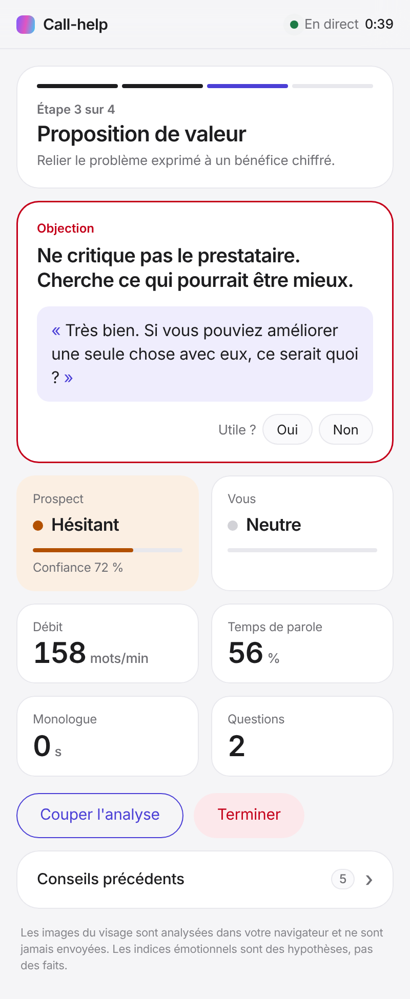
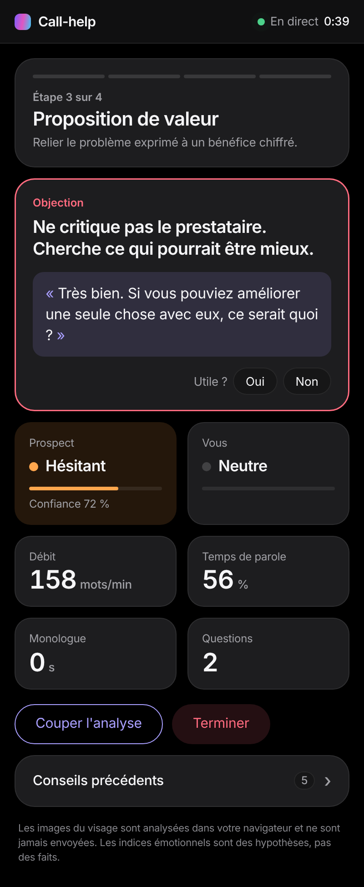

# Call-help

Copilote d'appel en temps réel pour cold calls, présentations et meetings en visio.
Il suit le fil directeur de l'appel et souffle des conseils au bon moment : réponse aux objections, prochaine étape, rythme. Il s'appuie aussi sur une lecture du ton et des expressions de l'interlocuteur.

<p>
  
  
</p>

## Documents

- [`docs/decisions.md`](docs/decisions.md) — décisions produit et points de vigilance
- [`docs/architecture.md`](docs/architecture.md) — architecture, protocole, options open source, planning
- [`docs/questions-projet.md`](docs/questions-projet.md) — les 50 questions de cadrage
- [`docs/donnees-synthetiques.md`](docs/donnees-synthetiques.md) — générateur des 1 000 appels synthétiques (Claude + ElevenLabs)
- [`docs/demos.md`](docs/demos.md) — **démos en direct** des appels générés, et ce qui marche / ne marche pas encore

## Structure

```
backend/app      API FastAPI + WebSocket : scénario, métriques, émotions, moteur de conseils
backend/datagen  Générateur d'appels synthétiques annotés et évaluation du moteur
extension/       Extension Chrome (React) : panneau latéral, capture de l'onglet d'appel
```

## Lancer en local

Récupérer le projet (une seule fois) :

```bash
git clone https://github.com/valentinjeambrun2-maker/Call-help.git
```

```bash
cd Call-help && git checkout claude/trusting-noether-ou47yu
```

Backend (Python 3.11+), depuis le dossier `Call-help` :

```bash
cd backend && python3 -m venv .venv && .venv/bin/pip install -e '.[dev,llm]'
```

```bash
.venv/bin/uvicorn app.main:app --reload --port 8000
```

Sans clé API, seuls les conseils par règles sont actifs. Pour les conseils affinés par l'IA, définissez `ANTHROPIC_API_KEY` avant de lancer le backend.

Panneau en mode navigateur (démo, sans extension), dans un second terminal, depuis le dossier `Call-help`. Il faut **Node.js 20 ou plus récent** (`node -v` pour vérifier).

```bash
cd extension
npm install
npm run dev
```

Ouvrez ensuite :
- **http://localhost:5173/demo.html** : démos en direct des appels générés (son réel, transcription ElevenLabs, conseils et bilan Claude, avec ce que l'assistant aurait dû faire). Voir [`docs/demos.md`](docs/demos.md).
- http://localhost:5173/sidepanel.html : le panneau seul, comme dans l'extension.

Clés à mettre dans `backend/.env` (modèle : `backend/.env.example`) : `ANTHROPIC_API_KEY` pour les conseils et le bilan, `ELEVENLABS_API_KEY` pour la transcription en direct.

> **Ne jamais publier ce fichier.** `backend/.env` reste sur votre ordinateur : git l'ignore, mais l'interface web de GitHub (renommer ou créer un fichier en ligne) contourne cette protection. Le dépôt est public : une clé publiée est lisible par tous, et Anthropic révoque automatiquement celles qu'il repère sur GitHub.

Extension Chrome, pour un vrai appel : voir [`docs/extension.md`](docs/extension.md).

## Tests

```bash
cd backend
.venv/bin/pytest
```

Rejouer un appel annoté en ligne de commande :

```bash
cd backend
.venv/bin/python -m demo.replay
```

Générer et évaluer des appels synthétiques : voir [`docs/donnees-synthetiques.md`](docs/donnees-synthetiques.md).
