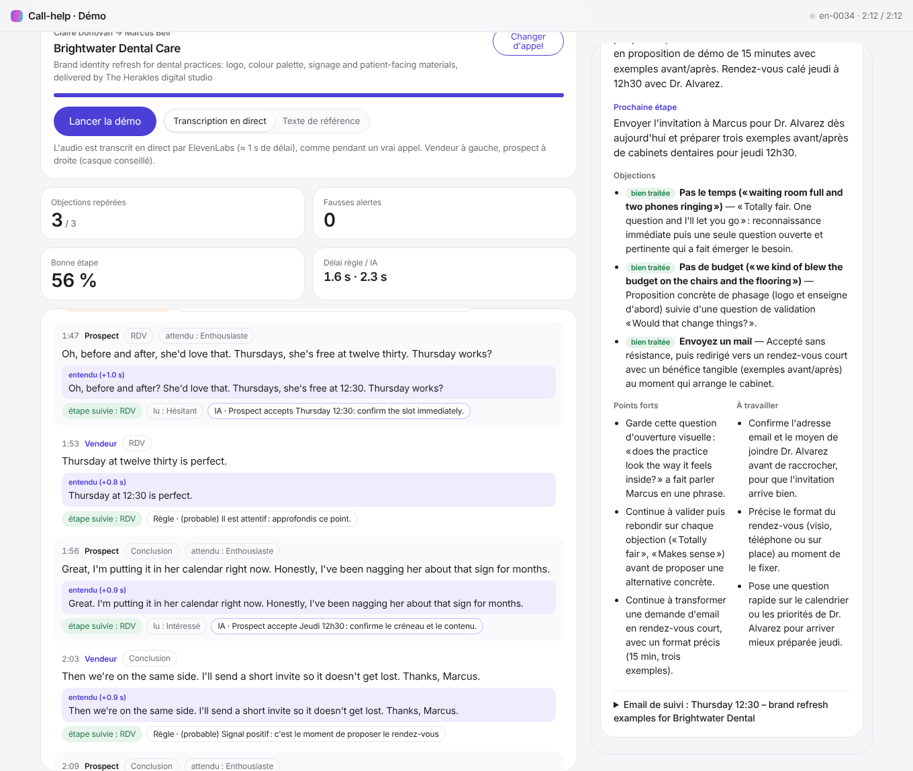

# Démos en direct avec les appels générés



La page de démo rejoue un appel généré par Claude et ElevenLabs, avec le vrai son, et montre en direct ce que fait l'assistant :
- **à droite**, ce que voit le vendeur ;
- **à gauche**, ce qu'il aurait dû faire, réplique par réplique.

## Lancer la page

Deux terminaux, depuis le dossier `Call-help`.

1. Backend. Clés dans `backend/.env` : `ANTHROPIC_API_KEY` pour les conseils et le bilan, `ELEVENLABS_API_KEY` pour la transcription en direct.

```bash
cd backend && .venv/bin/uvicorn app.main:app --port 8000
```

2. Page :

```bash
cd extension && npm run dev
```

Ouvrez **http://localhost:5173/demo.html**. Dix appels sont fournis dans le dépôt (`backend/demo/calls`, 15 Mo) :
- 5 en français, 5 en anglais ;
- les 4 objections, les 5 issues d'appel et les 5 émotions sont toutes représentées.

Les appels générés localement (`python -m datagen pilot`) s'ajoutent à la liste.

**Deux modes :**

| Mode | Ce qui se passe | Pour quoi faire |
|---|---|---|
| **Transcription en direct** (par défaut) | L'audio est découpé en deux canaux 16 kHz dans le navigateur, envoyé au backend au rythme de la lecture, transcrit par ElevenLabs, puis analysé. C'est le chemin d'un vrai appel. | Voir l'assistant dans les conditions réelles (≈ 0,40 $ par heure d'audio, plus Claude) |
| **Texte de référence** | Le texte exact de chaque réplique est envoyé à la fin du tour. | Isoler les erreurs de l'assistant de celles de la transcription |

**Ce que montre la colonne de gauche, pour chaque réplique :**
- le texte de référence et, en mode direct, ce que la transcription a **entendu**, avec son délai ;
- l'étape attendue et l'émotion attendue ;
- ✔ ou ✘ sur chaque objection attendue (repérée par les mots-clés ou par l'IA) ;
- l'étape suivie par l'assistant et l'émotion qu'il a lue ;
- les conseils émis. Une fiche barrée a été corrigée par l'IA.

Le **tableau de bord** en haut compte les objections repérées, les fausses alertes, la bonne étape, et le délai des règles et de l'IA après la fin de la parole. En fin d'appel, le **bilan IA** s'affiche à droite.

## Ce qui marche, ce qui ne marche pas encore

Mesuré le 5 novembre 2026 sur les 10 appels de démo, joués en direct (transcription ElevenLabs, conseils Claude Haiku 5.5, bilan Claude Opus 5.5).

| | Résultat | Commentaire |
|---|---|---|
| Transcription | **3,5 % d'erreurs de mots** (4 600 mots), délai médian **1,0 s** | Fiable. Les noms de marque passent mal (« The Herakles » → « Studio des Héraclès »). |
| Délai des conseils après la fin de la parole | règles **≈ 1,3 s**, IA **≈ 2,3 s** | Dans la cible de 1 à 3 s |
| Issue de l'appel dans le bilan IA | **10/10 justes** | RDV, rappel, envoi d'infos, refus. Bilan prêt en ≈ 15 s, ≈ 0,04 $ |
| Objections repérées | **21/30 (70 %)**, 4 fausses alertes | Contre 19/30 avant les corrections du jour. Variable d'une exécution à l'autre. |
| Étape suivie | **≈ 72 %** des tours | Reste souvent sur « Qualification » trop longtemps |
| Ressenti lu dans les mots | **≈ 38 %** d'accord exact avec l'émotion attendue | Faible. Les émotions attendues des appels synthétiques sont elles-mêmes incertaines. |
| Ressenti lu dans la voix | non branché | Le meilleur modèle libre utilisable (emotion2vec+) ne fait guère mieux que le hasard sur ces voix (41 % contre 35 %), et ses données d'entraînement posent question pour un usage commercial. |

**Les objections encore manquées** (9 sur 30), trois cas à parts égales :
1. **Répétition volontairement ignorée :** le prospect revient sur une objection déjà levée, par exemple il redemande un mail. Le moteur ne re-signale pas une objection déjà levée, pour éviter le bruit.
2. **Reconnue mais non classée :** l'IA en parle dans son conseil sans la classer. Cela a été corrigé en partie : quand les mots-clés ont repéré l'objection, elle est désormais conservée.
3. **Formulation très indirecte :** « Côté sous, c'est serré », « we've already got a guy ».

**Corrigé grâce aux démos** (les mesures en lot ne le montraient pas) :
- En direct, une analyse de l'IA était annulée dès que le prospect reparlait : l'objection qu'elle contenait était perdue.
- Des fausses alertes des mots-clés (« par mail », « on a déjà ») étaient comptées comme objections levées, et bloquaient ensuite la vraie.
- L'étape avançait sur le premier « oui ».
- La transcription coupe une réplique à chaque pause : l'IA jugeait des fragments.
- L'IA écrivait « objection budget » dans son conseil sans cocher l'objection : elle classe désormais après avoir rédigé.

## Pistes suivantes

1. **Données réelles.** Quelques vrais appels enregistrés avec accord, pour mesurer ce que valent ces chiffres hors synthèse.
2. **Étape suivie.** Proposer au vendeur de corriger l'étape d'un clic, et s'en servir comme signal.
3. **Ressenti de la voix.** Demander l'accès à l'API Hume (français, temps réel), puis la comparer au ressenti lu dans les mots dans le mode revue.
4. **Vraie capture d'appel.** Brancher l'extension (onglet d'appel et micro) sur le même chemin audio que la démo.
